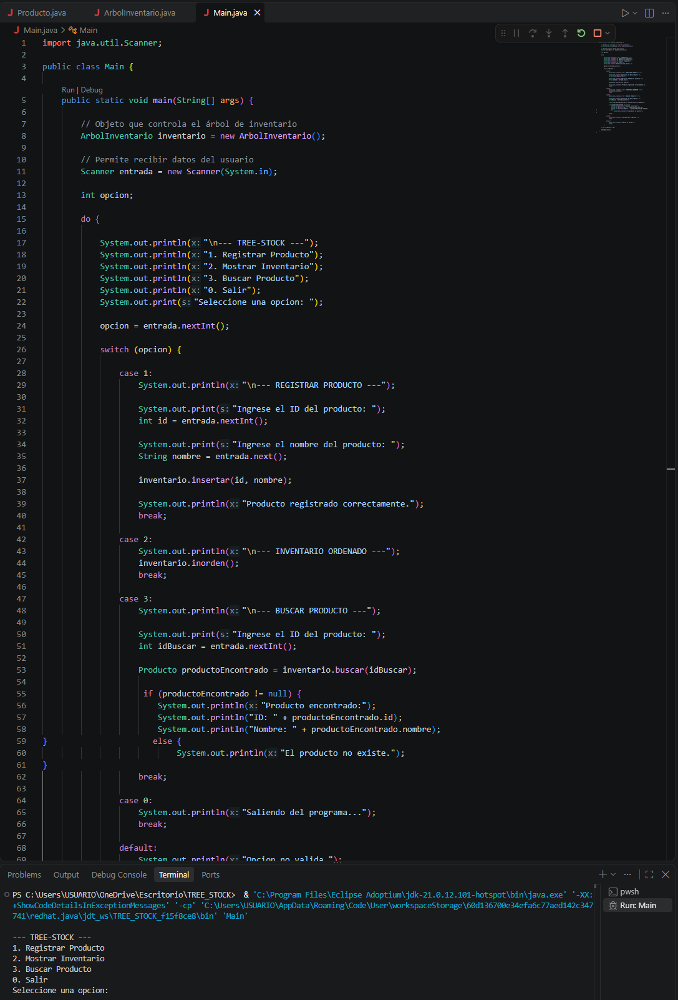
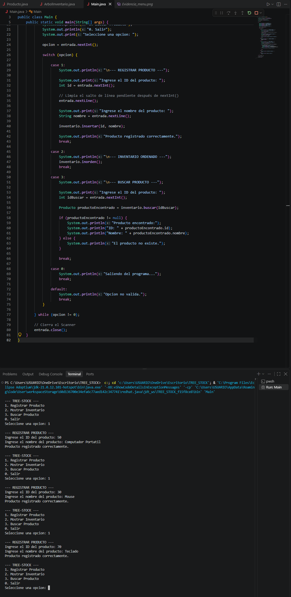
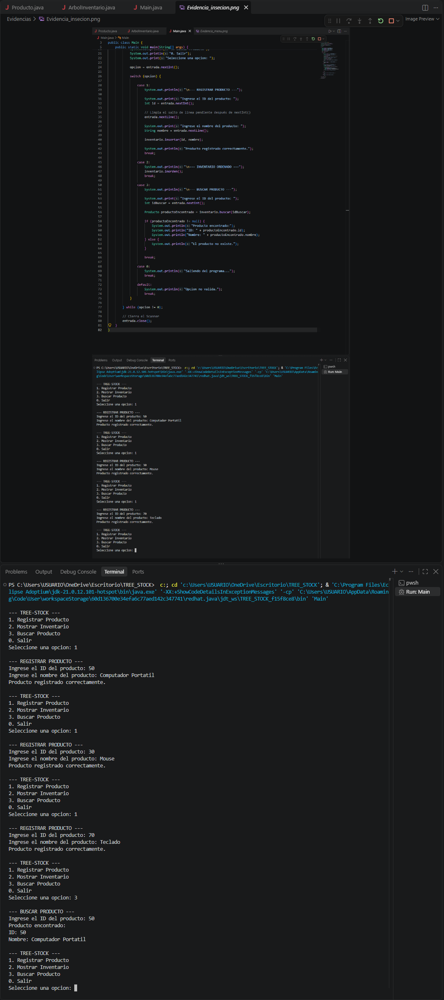

# Tree-Stock — Sistema de Inventario

**Autor:** Juan Esteban Muñoz Vásquez

## Objetivo

Desarrollar una aplicación de consola en Java para gestionar un inventario mediante un árbol binario de búsqueda, permitiendo registrar productos, mostrar el inventario ordenado y buscar productos mediante su ID.

La actividad permite aplicar estructuras dinámicas mediante nodos y referencias, además de utilizar control de versiones con GitHub.

## Conceptos fundamentales

Un árbol binario de búsqueda es una estructura de datos formada por nodos, donde cada nodo puede tener como máximo dos hijos: un hijo izquierdo y un hijo derecho.

En este proyecto, cada producto funciona como un nodo del árbol.

La organización se realiza utilizando el ID del producto:

- Los productos con un ID menor se ubican hacia la izquierda.
- Los productos con un ID mayor se ubican hacia la derecha.
- Cada producto puede tener una referencia hacia su hijo izquierdo y otra hacia su hijo derecho.

La raíz representa el primer nodo del árbol.

### Estructura del árbol

Por ejemplo, si se registran los productos con los ID 50, 30 y 70:

```text
        50
       /  \
     30    70
```

## Descripción del proyecto

Tree-Stock permite gestionar un inventario mediante un árbol binario de búsqueda.

El proyecto está dividido estrictamente en tres clases:

- **Producto.java:** representa el nodo del árbol y contiene el ID, nombre y referencias a los hijos izquierdo y derecho.
- **ArbolInventario.java:** contiene la lógica del árbol, incluyendo inserción recursiva, recorrido inorden y búsqueda por ID.
- **Main.java:** contiene la interfaz de consola y el menú interactivo.

La actividad fue implementada manualmente utilizando referencias entre objetos, sin utilizar estructuras de árbol prediseñadas de Java.

## Funcionamiento

### 1. Registrar Producto

Solicita al usuario:

- ID del producto.
- Nombre del producto.

El producto se crea como un nuevo nodo y se inserta en el árbol mediante el método `insertar()`.

La inserción es recursiva y compara el ID del nuevo producto con el ID del nodo actual para determinar si debe continuar por la izquierda o por la derecha.

### 2. Mostrar Inventario

Ejecuta el recorrido inorden del árbol.

El recorrido sigue el orden:

```text
Izquierda → Raíz → Derecha
```

Gracias a esta lógica, los productos se muestran ordenados de menor a mayor según su ID.

### 3. Buscar Producto

Solicita un ID y utiliza el método `buscar()` para localizar el producto.

La búsqueda también es recursiva:

- Si el ID coincide con el nodo actual, se encuentra el producto.
- Si el ID buscado es menor, la búsqueda continúa por la izquierda.
- Si el ID buscado es mayor, la búsqueda continúa por la derecha.
- Si se llega a `null`, significa que el producto no existe.

### 0. Salir

Finaliza la ejecución del programa y cierra el objeto `Scanner`.

## Instrucciones de ejecución

### Requisitos

- Eclipse Temurin JDK 21
- Visual Studio Code
- Extensión de Java para Visual Studio Code

### Ejecución desde Visual Studio Code

1. Abrir la carpeta `TREE_STOCK` en Visual Studio Code.
2. Abrir una terminal dentro de la carpeta del proyecto.
3. Compilar los archivos Java:

```text
javac *.java
```

4. Ejecutar el programa:

```text
java Main
```

5. Utilizar el menú de Tree-Stock para registrar, consultar y buscar productos.

## Tecnologías utilizadas

- Java
- Eclipse Temurin JDK 21
- Visual Studio Code
- Git
- GitHub

## Estructura del proyecto

```text
TREE_STOCK
│
├── Evidencias
│   ├── Evidencia_menu.png
│   ├── Evidencia_insercion.png
│   └── Evidencia_de_busqueda.png
│
├── Main.java
├── Producto.java
├── ArbolInventario.java
├── README.md
└── .gitignore
```

## Evidencias de ejecución

### Menú principal



### Registro de productos



### Búsqueda de producto



## Video de sustentación

https://drive.google.com/file/d/1eHKEb6k4roM15-LnWWzFQ1tDiEtUzTrB/view?usp=sharing

## Repositorio

Repositorio público de GitHub:

https://github.com/J4nus29/TREE_STOCK
